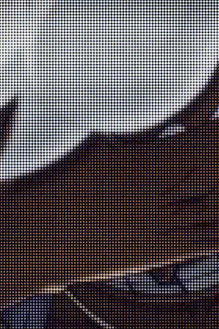

<h3>Hey, I'm Voxar 👋</h3>

Developer & designer who likes building things 
and figuring out how they work.

<b>🎮 Games &nbsp;·&nbsp; 🧩 Mods & tools &nbsp;·&nbsp; 🌐 Web &nbsp;·&nbsp; 🎨 Design</b>

<a href="https://voxar.dev"><b>voxar.dev</b></a> &nbsp;·&nbsp; <a href="https://github.com/VoxarDev"><b>GitHub</b></a> 
🌱 Always learning something new

 

<picture>
  <source media="(prefers-color-scheme: dark)" srcset="https://heatmap.shymike.dev?id=U0ACZLZFMPT&theme=dark&show_labels=true">
  
</picture>

⏱️ Coding activity · tracked with Hackatime